# MANUAL DEL USUARIO FINAL DE KASSA

**Versión 1.0 · Agosto de 2026**  
**Alcance:** operación comercial, inventario y posventa.

> Las capturas provienen del ambiente productivo y fueron anonimizadas. Los nombres de campos y botones se presentan en mayúsculas para coincidir con la interfaz.

## 1. ACCESO Y NAVEGACIÓN

1. Abra <https://www.kassapp.com/>.
2. Escriba el USUARIO y la CONTRASEÑA.
3. Seleccione INICIAR SESIÓN.
4. Confirme la empresa y la sucursal.

El panel resume ventas, órdenes activas, inventario bajo, clientes nuevos y estados del taller. Las opciones visibles dependen de los permisos del rol.

## 2. CONFIGURACIÓN INICIAL

1. En SEGURIDAD > EMPRESAS registre RAZÓN SOCIAL y NIT.
2. En CATÁLOGOS > SUCURSALES cree cada sede, asígnele MARCA PRINCIPAL y JEFE DE TALLER.
3. En SEGURIDAD > ROLES Y PERMISOS configure el acceso mínimo necesario.
4. En SEGURIDAD > USUARIOS asigne empresa, sucursal y rol.

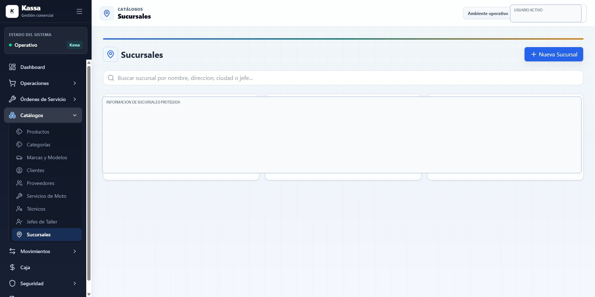

Cada sucursal funciona como una bodega. Las ubicaciones representan zonas físicas internas.

## 3. CATÁLOGOS

Antes de operar cree categorías, marcas/modelos, productos, clientes, proveedores, servicios y personal de taller.

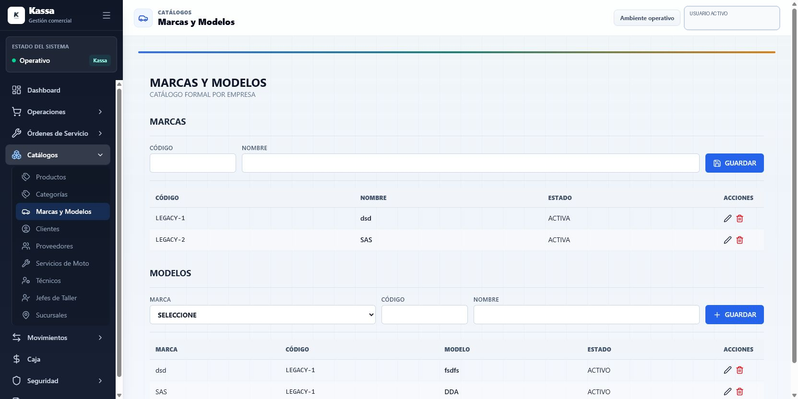

### PRODUCTOS

1. Abra CATÁLOGOS > PRODUCTOS y seleccione NUEVO PRODUCTO.
2. Registre tipo, SKU, código, nombre, categoría y marca.
3. Defina unidades base, compra y venta con sus factores; active FRACCIONADO cuando admita decimales.
4. Complete precios, impuestos, fabricante, origen, aplicabilidad, equivalencias, sustituciones, kits y reposición.
5. Guarde y compruebe la búsqueda por nombre, SKU o código.

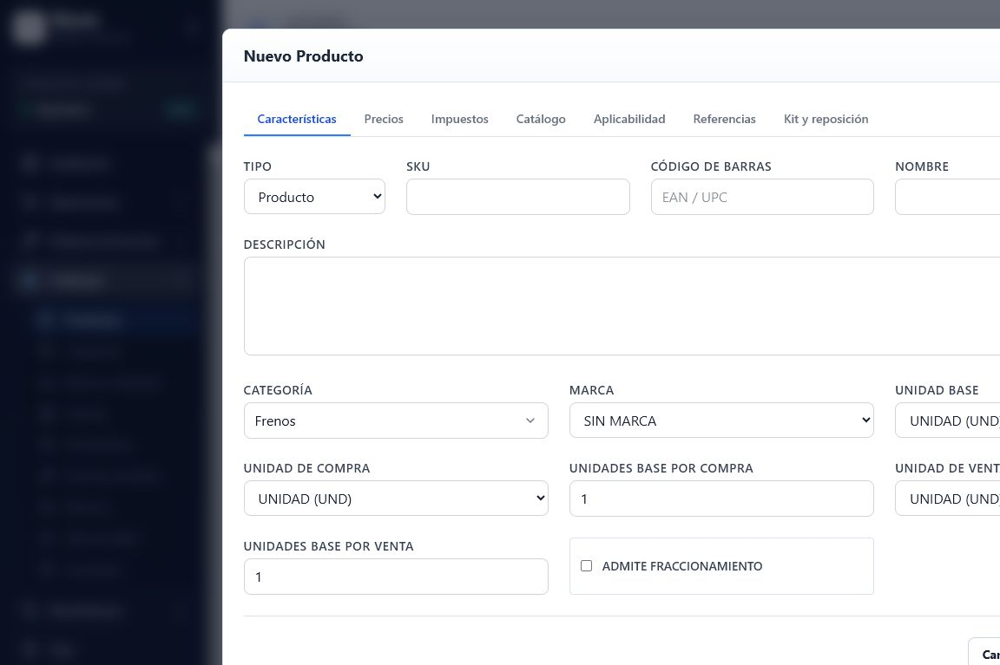

### CLIENTES Y PROVEEDORES

Evite duplicados por identificación. En proveedores seleccione TERCERO u OFICIAL; cuando sea oficial, asigne la marca correspondiente.

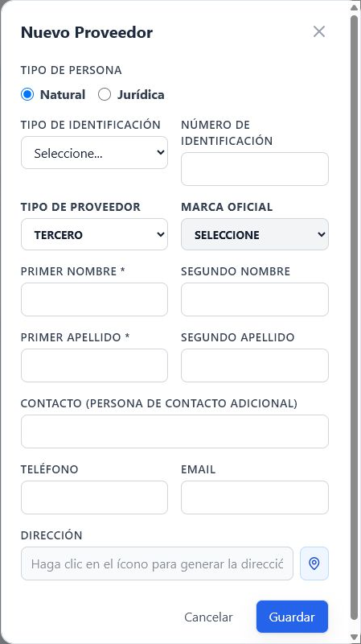

## 4. CAJA, VENTAS Y COTIZACIONES

1. Abra CAJA, cuente el efectivo y registre SALDO INICIAL.
2. En PUNTO DE VENTA seleccione cliente y artículos.
3. Revise cantidades, precios, descuentos, impuestos y total.
4. Seleccione PAGAR, elija el medio y confirme.
5. Entregue el comprobante.
6. Al terminar, concilie y cierre caja con el SALDO FINAL real.

En COTIZACIONES registre solicitante, artículos y cantidades; guarde y genere el PDF. En HISTORIAL DE VENTAS consulte detalles y registre devoluciones con inventario o notas crédito sin inventario, siempre con motivo.

## 5. ENTRADAS DE MERCANCÍA

1. Abra OPERACIONES > ENTRADAS DE MERCANCÍA > NUEVA ENTRADA.
2. Seleccione proveedor y registre fechas, factura o remisión.
3. Seleccione SUCURSAL, RECEPCIÓN EFECTIVA y UBICACIÓN DE RECEPCIÓN.
4. Registre pedido asociado cuando exista.
5. Agregue artículos con cantidad, unidad exacta, costo e impuesto.
6. Agregue flete cuando aplique, verifique y guarde.

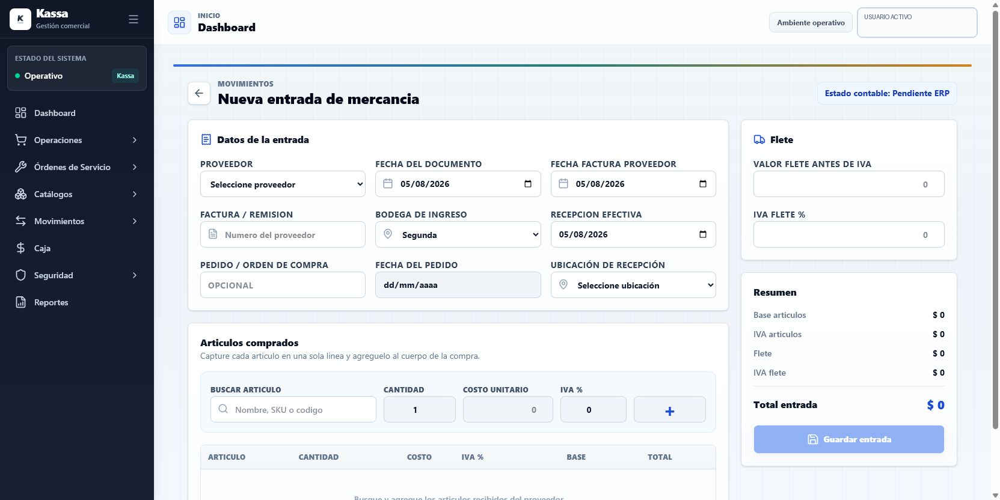

**Importante:** toda entrada debe indicar la ubicación física de recepción.

## 6. INVENTARIO, UBICACIONES Y MOVIMIENTOS

### CREAR UNA UBICACIÓN

1. Abra MOVIMIENTOS > INVENTARIO y seleccione la sucursal.
2. En UBICACIONES seleccione NUEVA UBICACIÓN.
3. Registre código, nombre y descripción.
4. Marque ES PREDETERMINADA solo para la ubicación habitual.

### ASIGNAR UN PRODUCTO EXISTENTE

Use AJUSTES para establecer el saldo físico inicial o corregirlo, indicando ubicación, nueva cantidad, costo y motivo. Use TRASLADOS cuando el producto ya tiene saldo en otra ubicación.

### TRASLADAR

1. Seleccione sucursal/ubicación de origen y destino.
2. Busque el producto y verifique disponibilidad.
3. Registre cantidad y observaciones.
4. Confirme y verifique ambos saldos.

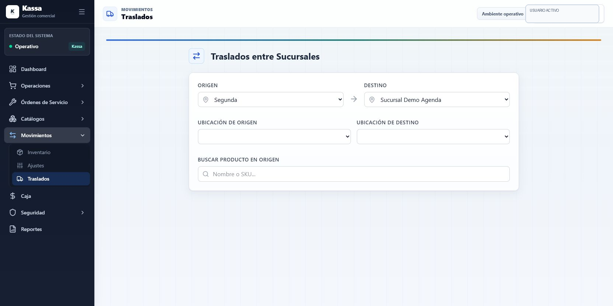

## 7. AGENDA

Configure una agenda, servicios y horarios. Comparta el enlace público autorizado. Gestione cada cita como PENDIENTE, CONFIRMADA, FINALIZADA o CANCELADA.

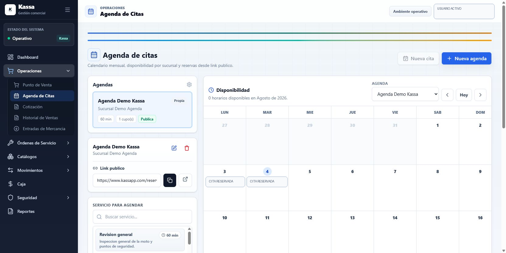

## 8. VEHÍCULOS Y ÓRDENES DE SERVICIO

El VIN o chasis de 17 caracteres es el identificador principal.

1. VEHÍCULOS UIO: cree o actualice el vehículo, propietario e historial.
2. INGRESO: reciba, documente kilometraje, tipo, origen, evidencia y firma.
3. DIAGNÓSTICO: registre hallazgos, recomendaciones y revisión asociada.
4. TRABAJOS: asigne servicios, técnico, pagador, facturación y tiempos.
5. REPUESTOS: cargue cantidades, unidades, pagador y efecto en factura.
6. CIERRE: verifique, facture, entregue y registre fecha real.

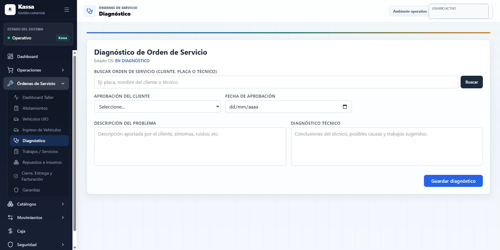

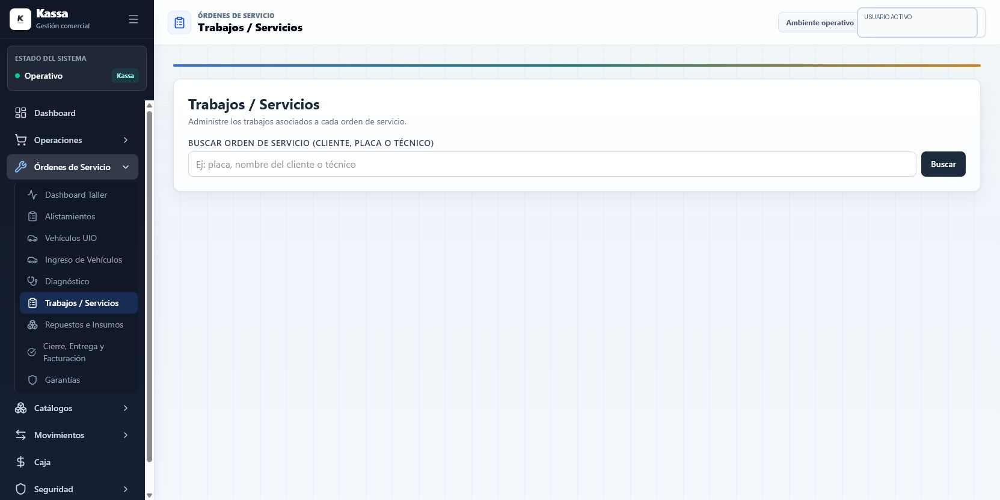

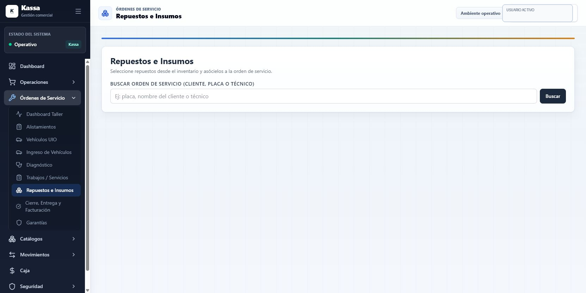

## 9. ALISTAMIENTOS

Registre referencia, sucursal, cliente, ejecutor, VIN, motor, placa, marca, modelo, año y kilometraje. Indique si abre garantía, documente hallazgos, revisiones, observaciones y consumos.

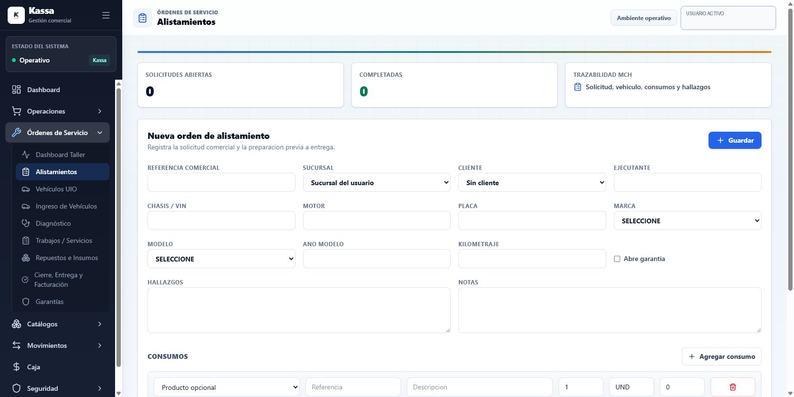

## 10. GARANTÍAS DEL FABRICANTE

1. Seleccione vehículo, tipo de garantía y punto de detección.
2. Asocie orden, fecha de falla y kilometraje.
3. Registre causa, modo de falla, pieza causante y reemplazos.
4. Registre autorización y radicación.
5. Actualice aprobación o rechazo y valores reconocidos.
6. Registre factura y pago del fabricante.

## 11. REPORTES

Seleccione el reporte, rango de fechas y filtros. Genere y revise ventas por sucursal, margen por producto, cotizaciones o historial de búsqueda.

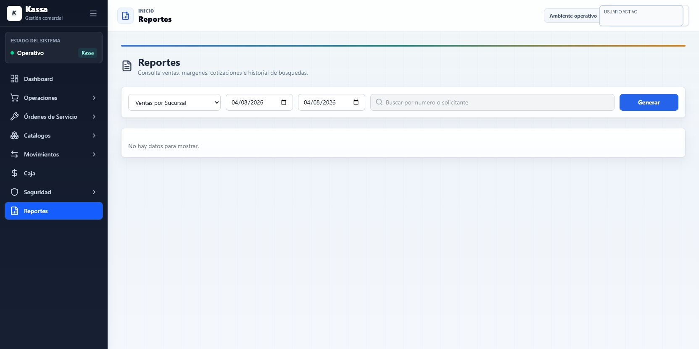

## 12. CONTROLES DIARIOS

- Inicio: confirmar empresa/sucursal, abrir caja, revisar citas, órdenes e inventario bajo.
- Cierre: actualizar órdenes, validar movimientos con soporte, conciliar y cerrar caja, cerrar sesión.
- Soporte: informe usuario, empresa, sucursal, fecha/hora, módulo, documento y pasos; nunca adjunte contraseñas.
