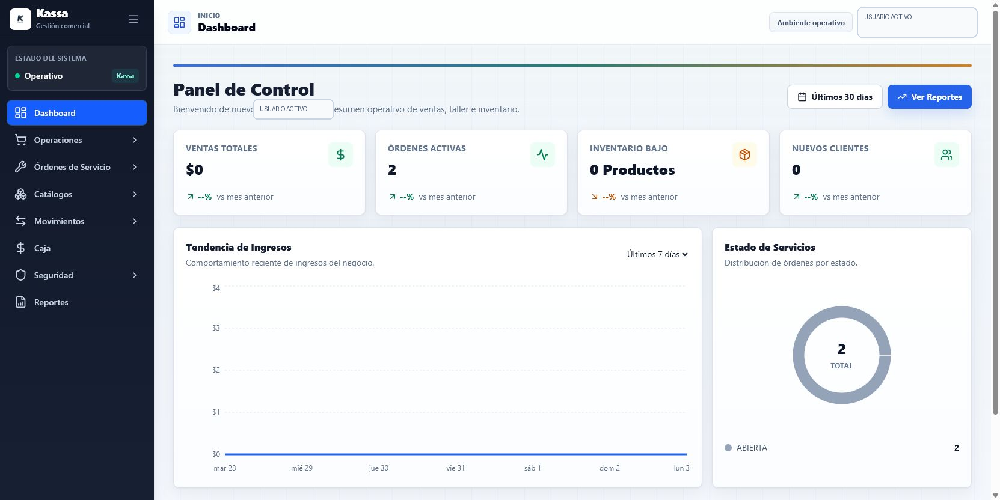
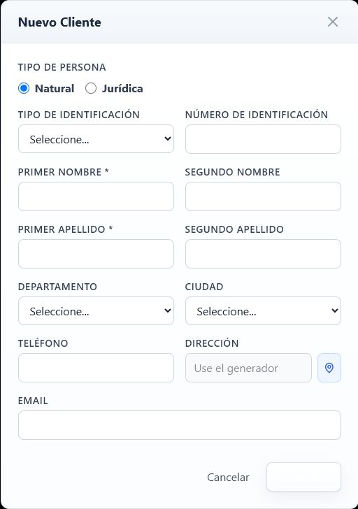
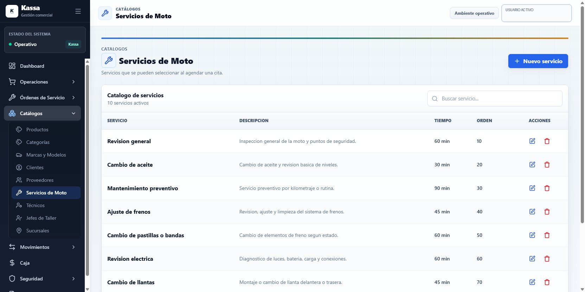
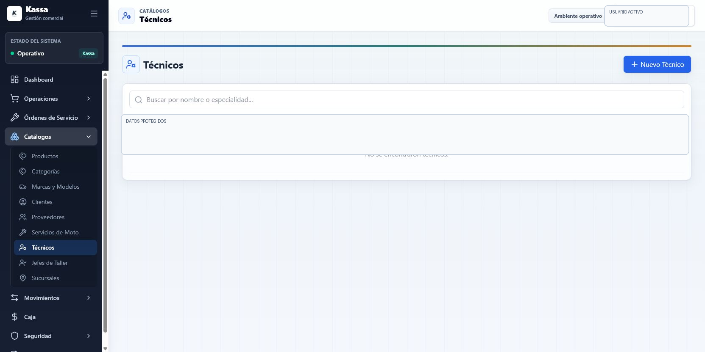
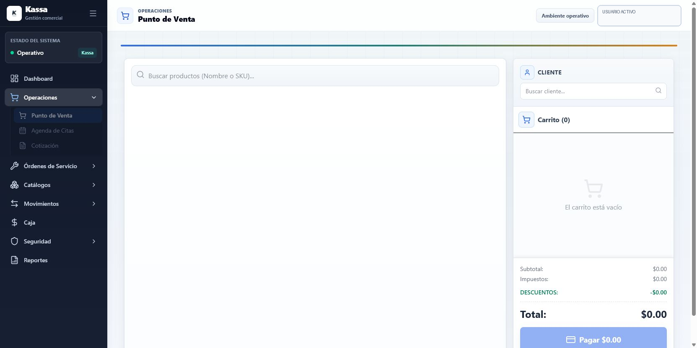
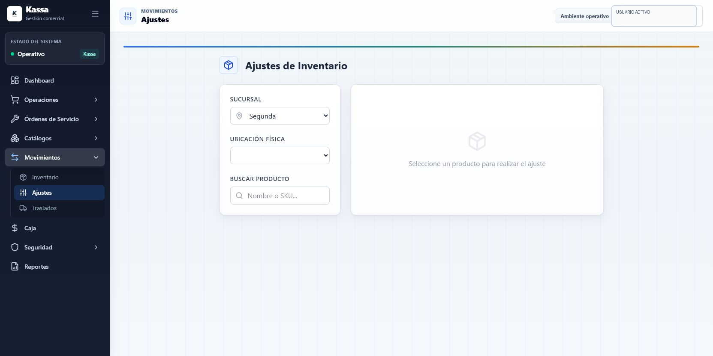
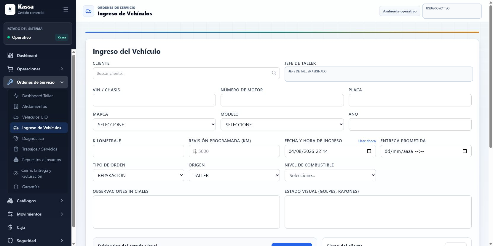
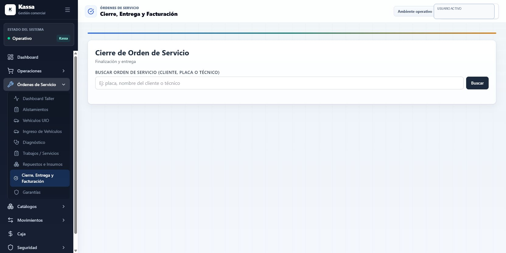
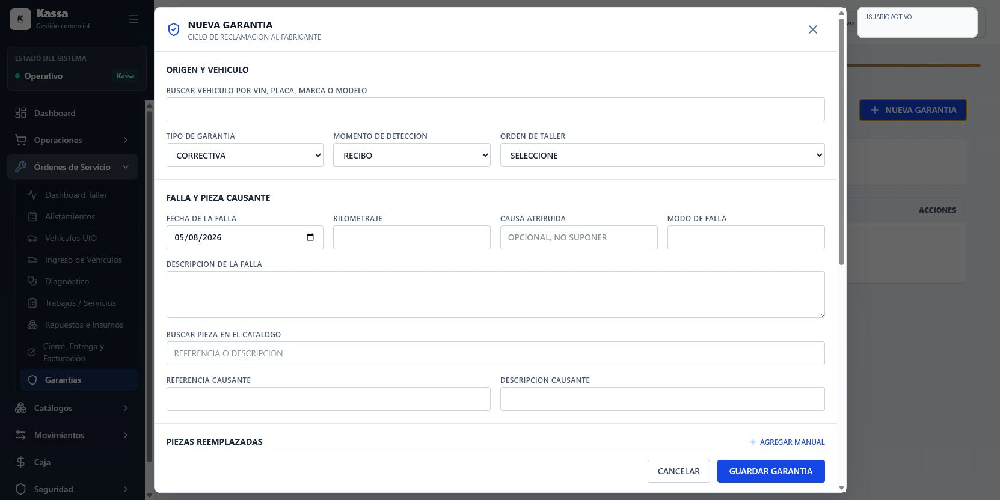

# MANUAL DEL USUARIO FINAL DE KASSA

**Versión 1.0 · Agosto de 2026**  
**Alcance:** operación comercial, inventario y posventa.

> Las capturas provienen del ambiente productivo y fueron anonimizadas. Los nombres de campos y botones se presentan en mayúsculas para coincidir con la interfaz.

## 1. ACCESO Y NAVEGACIÓN

1. Abra <https://www.kassapp.com/>.
2. Escriba el USUARIO y la CONTRASEÑA.
3. Seleccione INICIAR SESIÓN.
4. Confirme la empresa y la sucursal.

El panel resume ventas, órdenes activas, inventario bajo, clientes nuevos y estados del taller. Use BUSCAR EN EL MENÚ para localizar una opción, contraiga la navegación cuando necesite más espacio y utilice los accesos frecuentes para iniciar ventas, cotizaciones, citas, expedientes o consultas de inventario. Las opciones visibles dependen de los permisos del rol.

## 2. CONFIGURACIÓN INICIAL

1. En ADMINISTRACIÓN > EMPRESAS registre RAZÓN SOCIAL y NIT.
2. En CATÁLOGOS > SUCURSALES cree cada sede, asígnele MARCA PRINCIPAL y JEFE DE TALLER.
3. En ADMINISTRACIÓN > ROLES Y PERMISOS configure el acceso mínimo necesario.
4. En ADMINISTRACIÓN > USUARIOS asigne empresa, sucursal y rol.

Cada sucursal funciona como una bodega. Las ubicaciones representan zonas físicas internas.

## 3. CATÁLOGOS

Antes de operar cree categorías, marcas/modelos, productos, clientes y proveedores. Revise los servicios de moto predeterminados y complete el personal de taller.

### PRODUCTOS

1. Abra CATÁLOGOS > PRODUCTOS y seleccione NUEVO PRODUCTO.
2. Registre tipo, SKU, código, nombre, categoría y marca.
3. Defina unidades base, compra y venta con sus factores; active FRACCIONADO cuando admita decimales.
4. Complete precios, impuestos, fabricante, origen, aplicabilidad, equivalencias, sustituciones, kits y reposición.
5. Guarde y compruebe la búsqueda por nombre, SKU o código.

### CLIENTES Y PROVEEDORES

Evite duplicados por identificación. En proveedores seleccione TERCERO u OFICIAL; cuando sea oficial, asigne la marca correspondiente.

### SERVICIOS DE MOTO Y PERSONAL

1. Abra SERVICIOS MOTO y revise los diez servicios predeterminados.
2. Ajuste nombre, descripción, tiempo estimado, precio fijo antes de IVA, porcentaje de IVA y orden de visualización.
3. Cree servicios adicionales para los trabajos propios del taller y defina su precio e impuesto.
4. En TÉCNICOS registre el personal que ejecuta los trabajos.
5. En JEFES DE TALLER registre los responsables y asígnelos a las sucursales.

## 4. CAJA, VENTAS Y COTIZACIONES

1. Abra CAJA, cuente el efectivo y registre SALDO INICIAL.
2. En PUNTO DE VENTA seleccione cliente y artículos.
3. Revise cantidades, precios, descuentos, impuestos y total.
4. Seleccione PAGAR y elija el medio. Si el cliente tiene saldo a favor, escriba el valor que desea usar o seleccione USAR SALDO; el sistema descuenta ese anticipo del valor pendiente por recibir.
5. Registre el MONTO RECIBIDO. Cuando el cliente entregue más dinero que el total pendiente, active GUARDAR EXCEDENTE COMO ANTICIPO para conservarlo a su favor; si no lo activa, el excedente se calcula como cambio.
6. Confirme el pago y entregue el comprobante. Este discrimina el dinero recibido, el anticipo aplicado o creado, el cambio y el nuevo saldo del cliente.
7. Al terminar, concilie y cierre caja con el SALDO FINAL real. La caja contabiliza el dinero efectivamente retenido, sin duplicar los anticipos aplicados.

En COTIZACIONES registre solicitante, artículos y cantidades; guarde y genere el PDF. Cuando un artículo tenga porcentaje de utilidad, el precio sugerido se calcula desde su costo de inventario y contempla el IVA si está configurado como incluido. La cantidad cotizada no reserva ni descuenta inventario.

### FACTURAR UNA COTIZACIÓN POR ENTREGAS

1. En la confirmación seleccione CONVERTIR EN VENTA. Para retomar una cotización, abra REPORTES > COTIZACIONES EMITIDAS y use FACTURAR PENDIENTES.
2. Seleccione o cree el cliente. La primera factura lo deja asociado a la cotización.
3. El punto de venta carga solo las líneas pendientes con existencia en la sucursal. Registre la cantidad que realmente entregará.
4. Confirme el pago. La factura conserva la COTIZACIÓN ORIGEN y el inventario descuenta únicamente lo entregado.
5. Si recibe dinero por mercancía todavía pendiente, active GUARDAR EXCEDENTE COMO ANTICIPO.
6. Cuando llegue el saldo, regrese a la cotización, facture las unidades pendientes y aplique el anticipo disponible.

Ejemplo: cotice 10, facture y entregue 8, y conserve como anticipo el valor de 2. La cotización queda PARCIAL hasta facturar las 2 unidades restantes. En HISTORIAL DE VENTAS cada factura muestra su cotización de origen.

### CONSULTAR ANTICIPOS DE CLIENTES

1. Abra OPERACIONES > ANTICIPOS DE CLIENTES.
2. Busque por nombre o identificación y seleccione el cliente.
3. Revise el SALDO DISPONIBLE y cada movimiento: RECIBIDO aumenta el saldo y APLICADO lo disminuye.
4. Use la factura, referencia, sucursal, fecha y forma de pago para auditar el origen o la aplicación del valor.

Las cuentas con saldo cero permanecen disponibles para consulta histórica. Los anticipos no se editan ni se borran desde esta pantalla; se constituyen y aplican al confirmar ventas para conservar la trazabilidad.

## 5. ENTRADAS DE MERCANCÍA

1. Abra OPERACIONES > ENTRADAS DE MERCANCÍA > NUEVA ENTRADA.
2. Seleccione proveedor y registre fechas, factura o remisión.
3. Seleccione SUCURSAL, RECEPCIÓN EFECTIVA y UBICACIÓN DE RECEPCIÓN.
4. Registre pedido asociado cuando exista.
5. Agregue artículos con cantidad, unidad exacta, costo e impuesto.
6. Agregue flete cuando aplique, verifique y guarde.

**Importante:** toda entrada debe indicar la ubicación física de recepción.

## 6. INVENTARIO, UBICACIONES Y MOVIMIENTOS

### CREAR UNA UBICACIÓN

1. Abra INVENTARIO > EXISTENCIAS y seleccione la sucursal.
2. En UBICACIONES seleccione NUEVA UBICACIÓN.
3. Registre código, nombre y descripción.
4. Marque ES PREDETERMINADA solo para la ubicación habitual.

### ASIGNAR UN PRODUCTO EXISTENTE

Use AJUSTES para establecer el saldo físico inicial o corregirlo, indicando ubicación, nueva cantidad, costo y motivo. Use TRASLADOS cuando el producto ya tiene saldo en otra ubicación.

### TRASLADAR

1. Seleccione sucursal/ubicación de origen y destino.
2. Busque el producto y verifique disponibilidad.
3. Registre cantidad y observaciones.
4. Confirme y verifique ambos saldos.

## 7. AGENDA

Configure una agenda, servicios y horarios. Comparta el enlace público autorizado. Gestione cada cita como PENDIENTE, CONFIRMADA, FINALIZADA o CANCELADA.

## 8. VEHÍCULOS Y ÓRDENES DE SERVICIO

El VIN o chasis de 17 caracteres es el identificador principal. Abra TALLER > EXPEDIENTES para gestionar todo el proceso sin cambiar de pantalla. A la izquierda se buscan y seleccionan órdenes; a la derecha permanecen disponibles las pestañas INGRESO, DIAGNÓSTICO, TRABAJOS Y REPUESTOS, y CIERRE Y FACTURA.

### CREAR Y COMPLETAR UN EXPEDIENTE

1. Seleccione NUEVO INGRESO. Verifique primero la fecha y hora, seleccione el cliente y asigne un técnico activo de la sucursal. Después registre vehículo, kilometraje, tipo, origen, estado visual, fotografías y firma del cliente. La entrega prometida es opcional y puede dejarse vacía. Al guardar, la orden se abre en el mismo expediente.
2. En DIAGNÓSTICO registre el problema informado, la conclusión técnica y la aprobación del cliente. El sistema conserva fecha y responsable.
3. En TRABAJOS Y REPUESTOS busque un servicio del catálogo. El técnico se muestra solo como información y no se vuelve a seleccionar: cada trabajo hereda automáticamente la asignación realizada en el ingreso. El sistema también carga el tiempo, el precio fijo y el IVA configurados. Defina pagador y tipo de servicio. Para mantenimiento preventivo registre el kilometraje de revisión. Al marcar un trabajo como REALIZADO, indique su tiempo real.
4. En la misma pestaña, busque los repuestos e insumos, indique cantidad, tipo y pagador, y confirme el consumo. Esta confirmación descuenta inventario y vincula el movimiento a la orden; todavía no genera factura.
5. En CIERRE Y FACTURA revise el diagnóstico, los trabajos, impuestos, repuestos y total estimado. Complete el checklist, registre el usuario que recibe y finalice la orden.
6. Seleccione el medio de pago y genere la factura. El sistema factura una sola vez los trabajos y repuestos cobrables y deja la orden CERRADA.

Las órdenes finalizadas, cerradas o anuladas quedan en modo consulta. La trazabilidad al final del expediente muestra cada cambio de estado, fecha, responsable y nota.

## 9. ALISTAMIENTOS

Registre referencia, sucursal, cliente, ejecutor, VIN, motor, placa, marca, modelo, año y kilometraje. Indique si abre garantía, documente hallazgos, revisiones, observaciones y consumos.

## 10. GARANTÍAS DEL FABRICANTE

1. Seleccione vehículo, tipo de garantía y punto de detección.
2. Asocie orden, fecha de falla y kilometraje.
3. Registre causa, modo de falla, pieza causante y reemplazos.
4. Registre autorización y radicación.
5. Actualice aprobación o rechazo y valores reconocidos.
6. Registre factura y pago del fabricante.

## 11. REPORTES

Seleccione el reporte, rango de fechas y filtros. Genere y revise ventas por sucursal, margen por producto, cotizaciones o historial de búsqueda.

## 12. CONTROLES DIARIOS

- Inicio: confirmar empresa/sucursal, abrir caja, revisar citas, órdenes e inventario bajo.
- Cierre: actualizar órdenes, validar movimientos con soporte, conciliar y cerrar caja, cerrar sesión.
- Ingreso rechazado: revise el mensaje mostrado y valide cliente, VIN, marca/modelo, sucursal, combustible y firma.
- Soporte: informe usuario, empresa, sucursal, fecha/hora, módulo, documento y pasos; nunca adjunte contraseñas.
